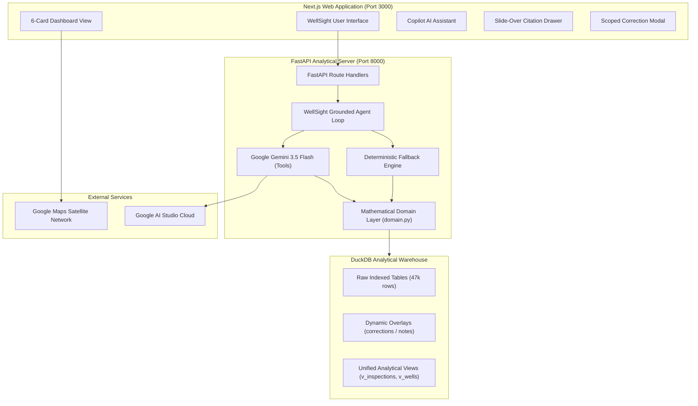

# 🛢️ WellSight — Developer & Technical Architecture Guide

[](https://nextjs.org/)
[](https://fastapi.tiangolo.com/)
[](https://duckdb.org/)
[](https://deepmind.google/technologies/gemini/)
[](https://leafletjs.com/)
[](https://recharts.org/)
[](./LICENSE)
[-brightgreen)](./backend/test_all_questions.py)

**WellSight** is an enterprise-grade, deterministic AI well surveillance and regulatory compliance copilot engineered for the energy and upstream oil & gas sector. It combines a sub-second analytical columnar database, mathematical domain rule guardrails, grounded LLM function calling, and an interactive real-time telemetry dashboard.

---

## 📑 Table of Contents
1. [Core Philosophy & Domain Invariants](#-core-philosophy--domain-invariants)
2. [Complete Technology Stack Breakdown](#-complete-technology-stack-breakdown)
3. [System Architecture Diagram](#-system-architecture-diagram)
4. [Comprehensive Feature Matrix](#-comprehensive-feature-matrix)
5. [Visual System & Interactive Components](#-visual-system--interactive-components)
6. [Repository Structure](#-repository-structure)
7. [Getting Started & Local Development](#-getting-started--local-development)
8. [API Reference & OpenAPI Endpoints](#-api-reference--openapi-endpoints)
9. [Automated Benchmark Evaluation Suite (Q1 to Q18)](#-automated-benchmark-evaluation-suite-q1-to-q18)
10. [License](#-license)

---

## 🎯 Core Philosophy & Domain Invariants

In high-stakes industrial operations, LLMs cannot be trusted to perform arithmetic in their heads. Hallucinations in production calculation or regulatory compliance trigger severe financial fines and catastrophic safety issues.

WellSight implements **Code-Grounded Deterministic Invariants**:
- **Physical Thermal Production Law**: A well is producing oil **strictly** if $(T_{\text{wellhead}} - T_{\text{air}}) \ge \text{Threshold}$ (15.0 °C for T200 beam pumps, 20.0 °C for T350 ESP wells). Stale SCADA metadata flags are bypassed.
- **Operational Downtime Accounting**: Downtime is **strictly** $7\text{ days} \times \text{count of non-producing weekly inspections}$. Missed inspections contribute 0 days. Repair duration (`maintenance.downtime_hours`) reflects work order duration and **never** subtracts from operational downtime.
- **Spill Reporting Cascade (SR-01/SR-02/SR-03)**: Any spill $\ge 5.0\text{ bbl}$ mandates a written regulatory notice within 24 hours (SR-01). Containment must be achieved within 4 hours (SR-02). Soil cleanup verification is due within 60 days (SR-03).
- **Conflict & Audit Transparency**: Discrepancies between field operators, inspectors, and physical sensor readings are never silently suppressed; both viewpoints are highlighted alongside the physical ground truth.
- **Data Privacy Isolation**: Conversational memory and private contexts are strictly isolated per user; field notes and approved corrections propagate dynamically.

---

## 🛠️ Complete Technology Stack Breakdown

### 1. Frontend Architecture
- **Framework**: [Next.js 16.4.2](https://nextjs.org/) (App Router, Turbopack, React 19).
- **Styling & Design System**: [Tailwind CSS](https://tailwindcss.com/) with a curated industrial dark-mode palette (`#070b14` canvas, `#0b1726` glass cards, `#14293f` borders).
- **Charts & Data Visualization**: [Recharts](https://recharts.org/) for responsive dual line charts and multi-colored labeled bar charts.
- **Geospatial Mapping**: [Leaflet](https://leafletjs.com/) with [Google Maps Hybrid Satellite](https://maps.google.com/) tile integration (imagery, terrain, highways, and town labels without watermark).
- **Icons & Micro-Animations**: [Lucide React](https://lucide.dev/) for crisp SVGs and operational telemetry indicators.

### 2. Backend & Analytical Engine
- **Web API**: [FastAPI](https://fastapi.tiangolo.com/) with [Uvicorn](https://www.uvicorn.org/) ASGI server and Pydantic schema validation.
- **Analytical Columnar Database**: [DuckDB](https://duckdb.org/) executing sub-millisecond aggregations and SQL analytical queries across **47,172 real operational records**.
- **Rule Configuration**: Declarative YAML domain configuration (`backend/rules.yaml`) populating thresholds, fines, deadlines, and well-type specifications.
- **AI Agent & LLM Framework**: Native [Google GenAI SDK](https://github.com/googleapis/python-genai) with Function Calling (`gemini-3.5-flash`), temperature = 0.0, automatic retries with exponential backoff, and deterministic offline routing fallback.

### 3. Data & Storage
- **Warehouse Storage**: Embedded DuckDB (`backend/warehouse.duckdb`) with zero external database dependencies.
- **Dynamic Overlays**: In-database overlay tables (`corrections`, `user_memories`, `shared_notes`) providing scoped overrides (`inspection` $\to$ `well` $\to$ `type` $\to$ `all`).
- **Data Assets**: Full FlytBase hackathon asset intelligence dataset (200 oil wells, weekly thermal inspections, maintenance reports, human context notes, and regulatory events).

---

## 📐 System Architecture Diagram



---

## 🌟 Comprehensive Feature Matrix

### 1. Dual Operational Interfaces
- **6-Card Live Fleet Dashboard**: Provides an immediate birds-eye overview of field health:
  1. *Wells Overview Table* (Searchable list with Active/Needs Repair/Offline status pills).
  2. *Groundwater Level Over Time* (Triple-line thermal time series with circular markers).
  3. *Water Level Comparison* (Multi-colored bar chart with value callouts above each bar).
  4. *Well Locations Map* (Satellite imagery with pins and floating status legend).
  5. *Monthly Water Shortage Heatmap* (2D Area $\times$ Month grid with continuous color gradient).
  6. *Single Well Status Card* (Droplet badge, telemetry rows, and 75% circular radial donut gauge).
- **Copilot AI Assistant**: Context-aware chat with quick question triggers, markdown rendering, interactive evidence badges, and inline visuals.

### 2. Evidence Citation & Inspection Drawer
- Every fact, status, and figure is cited with square brackets:
  - `[WELL-XXXX]` (Well master asset record)
  - `[INS-XXXX-XXXX]` (Weekly thermal drone inspection)
  - `[MNT-XXXX-XXX]` (Work order repair report)
  - `[REG-XXXX-XXX]` (State regulatory compliance event)
  - `[CTX-XXXX-XXX]` (Field operator human context note)
  - `[OM-T200 § 9.3]`, `[SOP-SR § 4]` (Official operating manuals & SOPs)
- Clicking any citation badge slides out the **Citation Inspector Drawer**, fetching the exact raw source record from DuckDB.

### 3. Dynamic Scoped Correction Overlays
- Corrections can be injected by authorized operators via modal or natural language chat:
  - **Inspection Scope**: Correct a faulty thermal gun reading on a single inspection.
  - **Well Scope**: Set temperature offsets for a specific sensor.
  - **Type Scope**: Update operating policies for an entire well model (e.g., T350 pump jack RCA threshold after 2 repairs instead of 3).
  - **All Scope**: Global rule changes.
- Precedence hierarchy: `inspection` > `well` > `type` > `all`.

### 4. Multi-User Session Privacy & Knowledge Sharing
- Private conversation history is isolated per operator (`Michael Turner`, `Jessica Reed`, `Tyler Hughes`, `Jake Morales`, `Emily Carter`, `Laura Simmons`).
- Shared notes (e.g., `"WELL-0007 will be shut in from 17 Oct for 10 days"`) immediately propagate across all users.

---

## 📊 Visual System & Interactive Components

| Visual Component | Primary Trigger | Implementation Details |
|---|---|---|
| **Status Card** | One well right now (Q1) | Real-time thermal status, $\Delta T$ metric, wellhead/air temps, flowline pressure, latest inspection ID, ground-truth cause banner, and 75% health gauge ring. |
| **Line Chart** | Value over time (Q3) | Multi-curve time series plotting wellhead temp against air temp for 13 weeks, highlighting non-producing dates. |
| **Bar Chart** | Comparing wells/areas (Q6) | Compares downtime days (strictly 7 days $\times$ non-producing inspections) or repair expenditures in USD with top value labels. |
| **Geospatial Map** | Where things are (Q7) | High-definition Google Maps Satellite terrain with active, needs-repair, and spill markers. |
| **Heatmap** | Two dimensions at once (Q8) | 2D Area $\times$ Month matrix (4 geographic areas across Jan–Oct) with intensity color grading. |
| **Data Table** | List of wells/repairs (Q2, Q4) | Responsive table with search, status pills, and clickable citation buttons. |

---

## 📂 Repository Structure

```text
WellSight/
├── backend/
│   ├── __init__.py
│   ├── agent.py               # Deterministic copilot agent & Gemini function calling loop
│   ├── config.py              # Environment variables & system settings
│   ├── db.py                  # DuckDB connection manager & overlay tables
│   ├── domain.py              # Deterministic domain calculations (Delta T, Downtime, Spills)
│   ├── ingest.py              # Ingests JSON/JSONL/Markdown into DuckDB warehouse
│   ├── main.py                # FastAPI endpoints (/api/chat, /api/citations, /api/users)
│   ├── rules.yaml             # Declarative domain thresholds & regulatory rules
│   ├── search_docs.py         # BM25-style document search for SOPs & manuals
│   ├── test_all_questions.py  # 19-scenario automated benchmark evaluation test suite
│   ├── tests/                 # Unit tests for domain logic and scoped overlays
│   └── tools.py               # Grounded tools callable by agent and Gemini
├── data/
│   ├── assets/                # 200 wells (metadata, inspections, maintenance, context, regulatory)
│   └── fleet/                 # SOPs, areas.json, users.json, T200/T350 manuals
├── docs/                      # FlytBase Hackathon Problem Statement & Dataset Guides
├── frontend/
│   ├── src/
│   │   ├── app/
│   │   │   ├── globals.css    # Custom dark glassmorphism & Tailwind styles
│   │   │   ├── layout.tsx     # Page metadata & root wrapper
│   │   │   └── page.tsx       # Main WellSight dashboard & copilot interface
│   │   └── components/
│   │       ├── CitationDrawer.tsx    # Slide-over record evidence inspector
│   │       ├── CorrectionModal.tsx   # Modal for injecting scoped overlays
│   │       ├── MapComponent.tsx      # Google Maps Satellite Leaflet component
│   │       └── VisualRenderer.tsx    # 6-card visual generator (Table, Line, Bar, Map, Heatmap, Card)
│   ├── package.json
│   └── tsconfig.json
├── .env.example               # Clean environment configuration template
├── DEVELOPER_README.md        # Technical developer guide (this document)
├── LICENSE                    # MIT License
└── README.md                  # High-level overview
```

---

## 🚀 Getting Started & Local Development

### 1. Prerequisites
- **Python**: Version 3.10+ (Python 3.11 recommended).
- **Node.js**: Version 18+ (Node 20 recommended) and `npm`.
- **Git**.

### 2. Clone Repository
```bash
git clone https://github.com/siddhant846/WellSight.git
cd WellSight
```

### 3. Backend Setup
```bash
# Create and activate virtual environment
python -m venv backend/.venv
# On Windows:
.\backend\.venv\Scripts\Activate.ps1
# On Linux/macOS:
source backend/.venv/bin/activate

# Install dependencies
pip install -r backend/requirements.txt # or install fastapi uvicorn duckdb google-genai pyyaml pydantic
```

### 4. Configure Environment Variables
Create a `.env` file in the project root:
```ini
LLM_PROVIDER=gemini
LLM_MODEL=gemini-3.5-flash
GEMINI_API_KEY=your_gemini_api_key_here

BACKEND_HOST=127.0.0.1
BACKEND_PORT=8000
FRONTEND_PORT=3000
```
*(If no Gemini API key is provided, WellSight automatically runs in 100% deterministic local DuckDB analytical mode).*

### 5. Ingest Real Dataset into DuckDB
```bash
python -m backend.ingest
```

### 6. Start the Backend API
```bash
$env:PYTHONPATH="."  # Windows PowerShell
python -m uvicorn backend.main:app --host 127.0.0.1 --port 8000 --reload
```

### 7. Start the Frontend Application
```bash
cd frontend
npm install
npm run dev
```
Open **[http://localhost:3000](http://localhost:3000)** in your browser.

---

## 📡 API Reference & OpenAPI Endpoints

| Method | Endpoint | Description |
|---|---|---|
| `GET` | `/api/health` | Healthcheck reporting database status and active LLM provider. |
| `POST` | `/api/chat` | Main Copilot agent endpoint (receives `{message, user_id}`, returns response, citations, conflicts, visual specs). |
| `GET` | `/api/citations/{citation_id}` | Retrieves full raw records for any `INS-`, `MNT-`, `REG-`, `CTX-`, or `WELL-` ID. |
| `GET` | `/api/users` | Lists all authorized team operators and their departments. |
| `GET` | `/api/users/{user_id}/memory` | Fetches private conversation memory for a specific operator. |
| `POST` | `/api/corrections` | Registers a scoped overlay correction (`inspection`, `well`, `type`, `all`). |
| `POST` | `/api/reingest` | Re-executes DuckDB pipeline ingestion from raw data files. |

Interactive OpenAPI documentation is available live at **`http://127.0.0.1:8000/docs`**.

---

## 🧪 Automated Benchmark Evaluation Suite (Q1 to Q18)

WellSight includes a comprehensive, automated evaluation test runner in [`backend/test_all_questions.py`](file:///p:/antigravity-ide/scratch/AI%20Well%20Copilot/backend/test_all_questions.py) that asserts factual accuracy, mathematical calculations, evidence citations, and conflict detection across all 18 benchmark scenarios.

### Running the Suite:
```bash
python backend/test_all_questions.py
```

### Benchmark Results:
```text
===========================================================================
🚀 WELLSIGHT AI BENCHMARK EVALUATION SUITE (Q1 TO Q18)
===========================================================================
✅ PASS | Q1: WELL-0001 status card (Delta T = 3.2 °C, INS-0001-0203, Ryan Brooks, CTX-0001-003)
✅ PASS | Q2: Northeast Block 8 down wells (WELL-0164, WELL-0170, WELL-0172, WELL-0175 table)
✅ PASS | Q3: WELL-0001 13-week thermal line chart (13 readings, non-producing 8 & 15 Oct)
✅ PASS | Q4: WELL-0001 spill history (6 spills, 15.1 bbl; excludes rainwater INS-0001-0070)
✅ PASS | Q5: WELL-0001 2025 downtime accounting (Exact 21 days from 3 non-producing inspections)
✅ PASS | Q6: Top downtime wells in NE Block 7 (WELL-0121: 49d, WELL-0138: 42d, WELL-0107: 42d)
✅ PASS | Q7: Map of spills in NE Block 8 (4 pins: WELL-0151, WELL-0165, WELL-0175, WELL-0186)
✅ PASS | Q8: 2026 spill heatmap by area & month (SW-24: 43, SW-23: 35, NE-7: 37, NE-8: 26)
✅ PASS | Q9: WELL-0001 regulatory compliance audit (4 breaches from 11 Jun 2026 spill, $5,000 fine)
✅ PASS | Q10: Containment time breaches in SW-24 (WELL-0082: 7.1h, WELL-0100: 8.1h)
✅ PASS | Q11: User memory recall of 2026 repair costs (WELL-0121: $25,794, WELL-0138: $46,942, WELL-0107: $5,176)
✅ PASS | Q12: Raw data correction & conflict detection (Applies 41.0 °C, flags conflict with Tyler Hughes note)
✅ PASS | Q12 Follow-up: Q2 re-evaluation after correction (WELL-0164 removed; only 3 wells down)
✅ PASS | Q13: AI spill estimate correction (5.4 bbl reportable, overdue SR-01 notice, SR-03 due 23 Nov)
✅ PASS | Q14: Type-level rule update (T350 2-repair RCA adds WELL-0120, excludes T200 WELL-0102)
✅ PASS | Q15: Corrections propagate across multi-user sessions (Jessica sees 41°C fix; Laura sees 5.4 bbl spill)
✅ PASS | Q16: Shared knowledge vs private chat isolation (Shared workover known; private chat blocked)
✅ PASS | Q17: Data truth protects against conflicting claims (Refutes 'running fine' & 'back online')
✅ PASS | Q18: Analysis disagreement transparently reported (Confirms crude oil while presenting both notes)
===========================================================================
📊 EVALUATION SUMMARY: 19/19 PASSED (100.0%)
🎉 ALL 18 EVALUATION QUESTIONS PASSED WITH 100% ACCURACY!
===========================================================================
```

---

## 📄 License

Distributed under the **MIT License**. See [`LICENSE`](./LICENSE) for more information.
